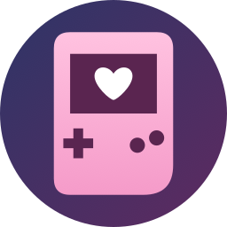
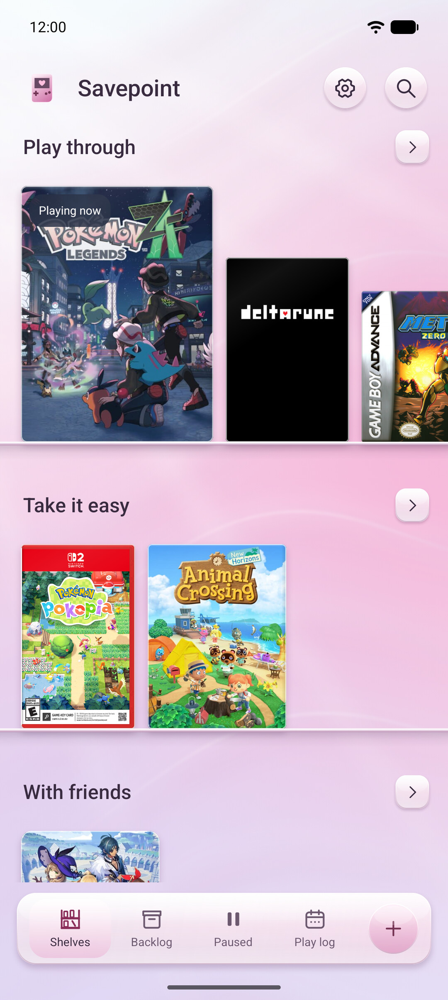
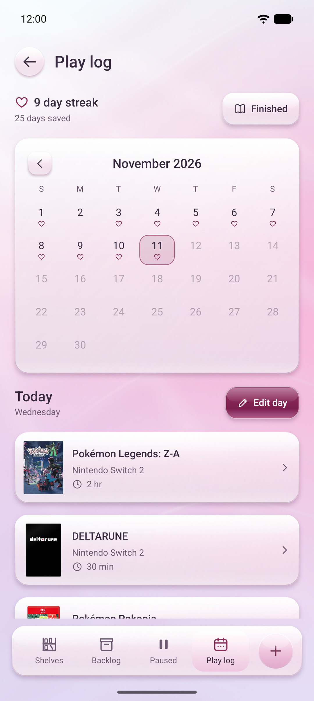
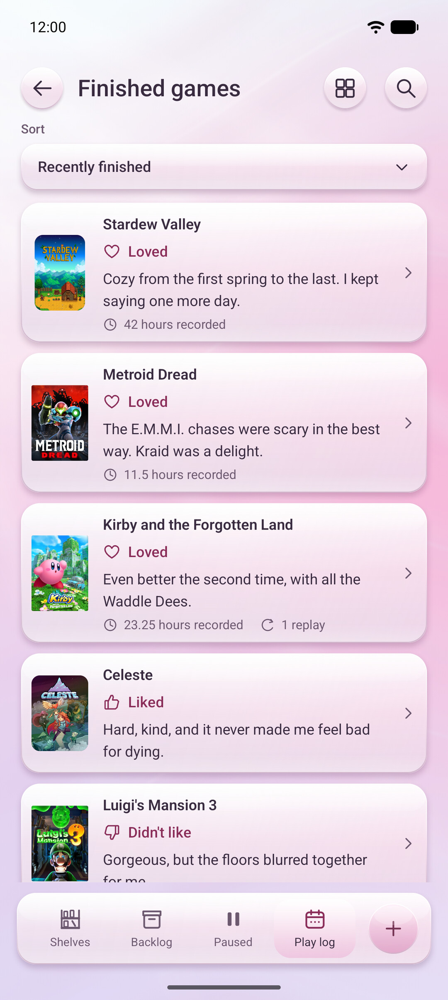
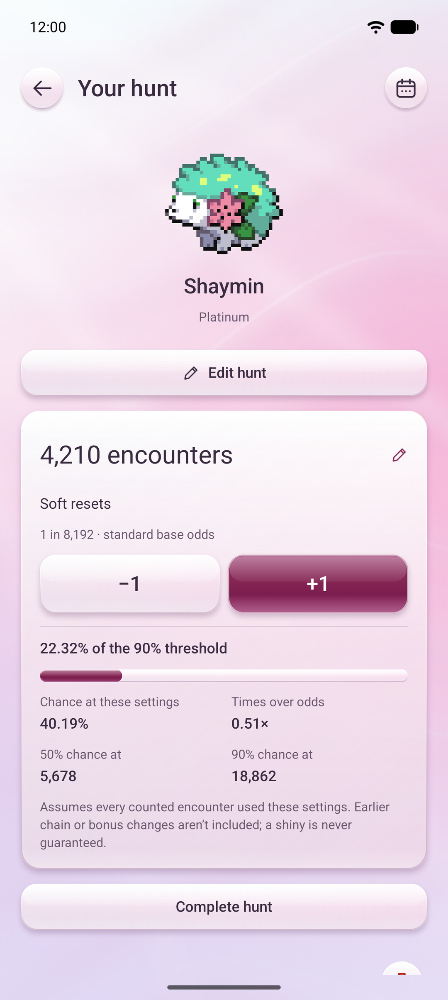

#  Savepoint

Savepoint is an Android app for keeping your place in your games. Organize your now-playing into shelves, keep games you intend to play in your backlog, and track your play history with the Play Log. Your library lives on your phone, so there's no account to make. <3

<p align="center">
  
  &nbsp;
  
  &nbsp;
  
  &nbsp;
  
</p>

## Features

- **Shelves:** Play through, Keep playing, Take it easy, With friends, and Shiny hunts. The first game on Play through is the one you're playing now, and the games after it are your near-future queue. Empty shelves stay hidden.
- **Backlog and paused games** with search, sorting by title, date added, release date, or system, and filters for a system or collection. Finished games sort by when you finished them or by title. All three have a list and a grid view.
- **Adding a game:** search LaunchBox's Games Database, Steam, and the App Store, then choose the box art you like. Games missing from those can be added by hand, and games installed on your phone can use their own app icon as a cover.
- **Covers shaped like game cases,** with plastic, cardboard, or digital finishes by system. Flat art is also available if you prefer.
- **Play log:** a calendar of the days you played, with optional time for each game. It counts your current streak and your lifetime days. Empty days stay plain, with no warnings or missed-day messages.
- **Finished games** keep every playthrough: the date, how it felt (didn't like, liked, or loved), your thoughts, and optional hours. Each game also keeps an overall replay count.
- **Notes** for each game, and a separate note for where you left off when you pause one.
- **Collections** that group games from anywhere in your library, in your own order.
- **Shiny hunts** for the main Pokémon games from Gold and Silver to Legends: Z-A. Each hunt has an encounter counter, the shiny sprite from the game you're hunting in, the odds for that game and method, and your chance of having seen a shiny by now.
- **A home-screen widget** with your playing-now game and a button to log play.
- **Optional reminders:** rest invitations on the days and times you choose, and an evening check-in for the play log around 9 pm. Both are off until you turn them on.
- **Appearance:** system, light, or dark theme, four shelf styles, and four app icon colors (Midnight, Lavender, Blush, and Berry).

## Install

Download the APK from the [latest release](../../releases/latest) and open it on your phone. The first time, Android asks you to allow installs from your browser or file manager. Savepoint needs Android 8.0 or later.

On first launch, Savepoint asks which systems you play on, so that search and manual entry only list those. You can change them any time in Settings.

## Your data

Your library lives only on your phone. Savepoint has no account and no analytics, and Android's cloud backup and device-to-device transfer are turned off for it.

Savepoint goes online only to:

- send the title you type to LaunchBox's Games Database, Steam, and Apple's App Store when you add a game or change a cover,
- download the cover art you choose, and
- download Pokémon pictures for shiny hunts: shiny sprites from Serebii, and the picker's regular sprites from PokéAPI's sprite collection on GitHub.

Covers are saved on the phone after their first download, so your shelves work offline. To offer the games installed on your phone, Savepoint reads your list of apps; that list never leaves the phone.

To keep a copy of your library or move it to a new phone, use **Export backup** in Settings. It writes a single ZIP file with your games, notes, play log, settings, and cover art. **Import backup** replaces the library on the phone with the one in the file. It asks you to confirm first, and it turns both reminders off.

## Building

You need JDK 17 or newer and the Android SDK with platform 37. Put your SDK's path in an untracked `local.properties`:

```properties
sdk.dir=/path/to/Android/Sdk
```

Then build, test, and lint:

```sh
./gradlew :app:assembleDebug :app:testDebugUnitTest :app:lintDebug
```

The APK is `app/build/outputs/apk/debug/app-debug.apk`. `./gradlew :app:assembleRelease` makes a minified release build.

The device tests change the library on the device they run on, and they uninstall the app, with its library, when they finish. Run them on an emulator, never on a phone you use:

```sh
./gradlew :app:connectedDebugAndroidTest
```

`tools/hunt-catalog/build.py` rebuilds the shiny-hunt catalog (`app/src/main/assets/hunt-catalog.json`) from pinned PKHeX and PokéAPI revisions. It needs a PKHeX checkout at the pinned revision (`--pkhex <path>`) and the .NET 10 SDK.

## Credits

- **PKHeX** by **Kaphotics and contributors**, for the encounter and form data in the shiny-hunt catalog
- **PokéAPI**, for Pokémon names, forms, and artwork
- **Serebii.net**, for shiny sprites and shiny odds
- **Rotom Labs**, **JS-Finder** by **Lincoln-LM**, and **3DSRNGTool** by **wwwwwwzx**, for shiny odds
- **LaunchBox Games Database**, **Steam**, and the **App Store**, for game search and cover art
- **Jetpack Compose**, **Room**, **DataStore**, **Glance**, and **WorkManager** by **The Android Open Source Project**, as part of Android Jetpack
- **kotlinx.coroutines** by **JetBrains**

## License

Savepoint is free software under the [GNU General Public License, version 3 or later](LICENSE). Some parts use other licenses: the shiny-hunt catalog includes data from PKHeX (GPL-3.0-or-later) and PokéAPI (BSD-3-Clause), and the Android Jetpack and kotlinx.coroutines libraries use the Apache License 2.0. Game artwork and Pokémon sprites belong to their owners. Savepoint downloads them when you ask, and they are not covered by the GPL. All the texts are in [`app/src/main/assets/licenses/`](app/src/main/assets/licenses/).

Savepoint isn't affiliated with Nintendo, The Pokémon Company, LaunchBox, Valve, or Apple.

---

*This project was made with AI assistance. For more information, see [my AI usage statement](https://github.com/cmyksoda/cmyksoda/blob/main/AI_USAGE.md).*
